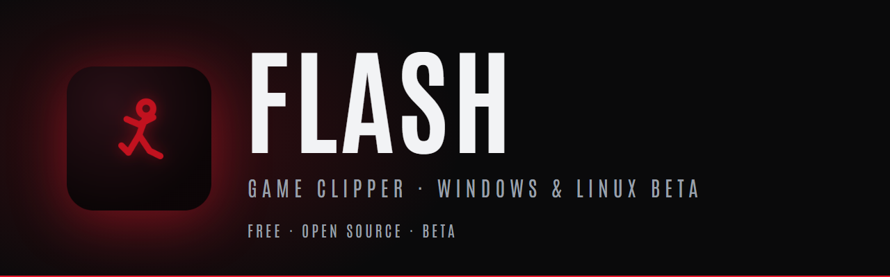
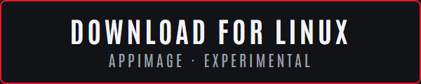

<p align="center">
  
</p>

<p align="center">
  <a href="https://github.com/lillyfloweruwu-arch/flash/releases/download/v0.1.0-beta.1/Flash.Setup.0.1.0-beta.1.exe"></a>
  &nbsp;
  <a href="https://github.com/lillyfloweruwu-arch/flash/releases/download/v0.1.0-beta.1/Flash-0.1.0-beta.1.AppImage"></a>
</p>

<p align="center">
  <a href="https://github.com/lillyfloweruwu-arch/flash/releases/tag/v0.1.0-beta.1">All downloads and notes</a>
</p>

<p align="center"><sub>Windows will warn that the installer is unsigned. Click <b>More info</b>, then <b>Run anyway</b>.</sub></p>

# Flash

Flash is a lightweight game clipper. It records in the background, and when something good happens you press a hotkey and the last seconds are saved as a clip. It has a built-in editor and a clip library, and is made to stay out of the way of your game.

This is an early beta. Expect rough edges, and please tell me about them (see Feedback below).

## Install on Windows

1. Go to the [Releases page](../../releases) and download `Flash Setup ...exe` from the newest release.
2. Run it. The installer is **not code-signed yet**, so Windows SmartScreen will show a blue "Windows protected your PC" box. That is expected for any unsigned app.
3. Click **More info**, then click **Run anyway**.
4. Flash installs for your user account only, so it does not ask for admin rights.

Some antivirus programs are also cautious about unsigned installers. The full source is in this repository if you want to check it or build it yourself.

## Install on Linux (experimental)

The Linux build is an AppImage on the Releases page. It builds and passes its automated checks, but it has had very little testing on real hardware. It needs PipeWire and the XDG desktop portal for screen capture, so it should work on current Ubuntu, Fedora and similar distributions on Wayland or X11. If it breaks, that is useful to know: please send feedback and include your distribution and desktop.

```bash
chmod +x Flash-*.AppImage
./Flash-*.AppImage
```

## Feedback

The **Feedback** button in the title bar sends a message straight to me. It sends only your message, the Flash version and your operating system. Nothing else is collected. Bug reports and ideas are both welcome, and the more detail the better.

## Build from source

You need Node 24 and pnpm 11. On Linux, see `.github/workflows/build.yml` for the native dependencies.

```bash
pnpm install
pnpm --filter @flash/capture run build
pnpm --filter @flash/desktop dev
```

## License

MIT, see [LICENSE](LICENSE). Third-party components are listed in [THIRD_PARTY_NOTICES.md](THIRD_PARTY_NOTICES.md).
